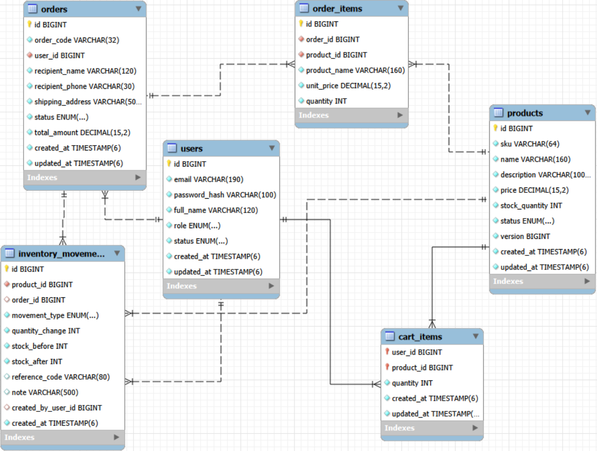

# Single Store Service

Phần đặc tả chi tiết của project ở trong [Đặc tả](https://docs.google.com/document/d/1xJSMMyIZH-bQcznc303Pgg2bISfpnnQMS04c3AmLzeQ/edit?tab=t.0#heading=h.bu5gafmtg044)

Backend một cửa hàng: công bố sản phẩm, đặt đơn và quản lý tồn kho.

## 1. Bài toán và phạm vi
- Cung cấp dịch vụ RESTful backend phục vụ web bán hàng tư nhân, bao gồm các phân hệ: Xác thực và người dùng, quản lý sản phẩm, giỏ hàng, đặt hàng và vòng đời đơn hàng. 
- Cửa hàng cần công bố sản phẩm, tiếp nhận đơn của khách, kiểm soát tồn kho và theo dõi trạng thái đơn.
- Phạm vi chỉ một cửa hàng và một nguồn tồn kho cho mỗi sản phẩm. Đơn lưu thông tin người nhận tại thời điểm mua.

| Tác nhân | Chức năng |
| --- | --- |
| Public | Xem/tìm sản phẩm `ACTIVE`, đăng ký và đăng nhập |
| CUSTOMER | Xem tài khoản, đổi mật khẩu, giỏ hàng, đặt/xem/tìm đơn của mình, hủy `PENDING` |
| ADMIN | Đổi mật khẩu, quản lý sản phẩm/kho, xem đơn toàn hệ thống và đổi trạng thái |

## 2. Nghiệp vụ
### 2.1.  Nghiệp vụ quản lý định danh và tài khoản
- Khách hàng: Đăng ký tài khoản mới, đăng nhập nhận JWT Token, tra cứu thông tin cá nhân (`/api/users/me`), đổi mật khẩu với các ràng buộc về độ an toàn.
- Phân quyền:
  * `PUBLIC`:  Xem thông tin sản phẩm, đăng ký, đăng nhập, kiểm tra hệ thống chạy thành công.
  * `CUSTOMER`: Quản lý giỏ hàng cá nhân, đặt hàng, tra cứu lịch sử đơn hàng, hủy đơn hàng cá nhân.
  * `ADMIN`: Quản trị danh mục sản phẩm, quản trị kho hàng, điều chỉnh số lượng tồn kho, quản lý và cập nhật trạng thái đơn hàng toàn hệ thống.
### 2.2. Nghiệp vụ quản lý sản phẩm và tồn kho
- Danh mục sản phẩm:
  * Tra cứu, tìm kiếm sản phẩm theo từ khóa, xem chi tiết sản phẩm và trạng thái kinh doanh (`ACTIVE`, `INACTIVE`).
  * Admin thực hiện thêm mới, cập nhật thông tin sản phẩm, cập nhật nhanh số lượng hàng tồn hoặc xóa sản phẩm.
- Quản trị kho:
  * Theo dõi chính xác lượng tồn kho của từng sản phẩm.
  * Ghi lại chi tiết lịch sử xuất/nhập/điều chỉnh kho (loại giao dịch SALE, ADJUSTMENT, ghi chú, người thực hiện, thời gian, số lượng thay đổi).
### 2.3. Nghiệp vụ giỏ hàng
- Giỏ hàng gắn liền với từng khách hàng đăng nhập. 
- Thêm mới sản phẩm vào giỏ, cập nhật số lượng, xóa từng món hoặc xóa toàn bộ giỏ. 
- Thanh toán nhanh: Chuyển toàn bộ các mặt hàng hợp lệ trong giỏ hàng thành đơn hàng chính thức. 
### 2.4. Nghiệp vụ đặt hàng và xử lý đơn hàng
- Tạo đơn hàng:
  * Hỗ trợ tạo đơn trực tiếp hoặc tạo đơn từ giỏ hàng.
  * Kiểm tra tính khả dụng của sản phẩm và lượng tồn kho thực tế trước khi xác nhận đơn.
- Theo dõi và tìm kiếm đơn hàng:
  * Khách hàng: Xem chi tiết đơn hàng, danh sách các đơn hàng đã đặt, tìm kiếm theo mã đơn hoặc trạng thái đơn hàng (PENDING, CONFIRMED, SHIPPING, DELIVERED, CANCELLED).
  * Khách hàng được quyền tự hủy đơn nếu đơn vẫn ở trạng thái `PENDING`.
- Quản lý đơn hàng phía Admin: Quản trị viên duyệt và cập nhật tuần tự các trạng thái của đơn hàng từ lúc tiếp nhận đến khi giao hàng thành công hoặc hủy đơn.

## 3. Công nghệ ử dụng
| Thành phần | Lựa chọn |
| :--- | :--- |
| Ngôn ngữ | Java 17+ |
| Framework | Spring boot 3.5, Spring security |
| Truy cập dữ liệu | Spring Data JPA/Hibernate kết hợp Spring JDBC |
| Cơ sở dữ liệu | MySql 8.4 khi chạy Docker, H2 trong bộ nhớ khi chạy mặc định. |
| Build | Maven Wrapper |
| Đóng gói | Docker, Docker Compose |
## 4. Kiến trúc
`HTTP + JWT filter → Controller → Service → Repository/port → Adapter JPA/JDBC → database`

- Đơn, trừ/hoàn kho và audit dùng cùng transaction, checkout thành công mới xóa giỏ. 
- Giá lấy từ database và lưu snapshot tên/giá trong đơn.
- Xóa mềm sản phẩm `INACTIVE`.
- Đơn đi theo `PENDING → CONFIRMED → SHIPPING → COMPLETED`; hủy `CANCELLED`.

## 5. Sơ dồ ER


## 6. API

### 6.1. Tài khoản và sản phầm
| Method | Đường dẫn | Quyền | Mục đích |
| :--- | :--- | :--- | :--- |
| POST | `/api/auth/register` | Public | Đăng ký tài khoản người dùng mới |
| POST | `/api/auth/login` | Public | Đăng nhập hệ thống bằng email và mật khẩu, trả về JWT Access Token |
| GET | `/api/user/me` | authenticated | Lấy thông tin cá nhân của tài khoản đang đăng nhập (id, email, họ tên, danh sách roles) |
| POST | `/api/user/me/password` | authenticated | Đổi mật khẩu cá nhân |
| GET | `/api/products` | public | Lấy danh sách sản phẩm có phân trang |
| GET | `/api/products/search` | public | Tìm kiếm sản phẩm theo từ khoá kết hợp phân trang |
| GET | `/api/products/{id}` | public | Lấy chi tiết thông tin của 1 sản phẩm theo ID |
| POST | `/api/products` | ADMIN | Tạo mới 1 sản phẩm (SKU, tên, mô tả, giá, tồn kho) |
| PUT | `/api/products/{id}` | ADMIN | Cập nhật toàn bộ thông tin sản phẩm (tên, mô tả, giá, số lượng tồn) |
| PATCH | `/api/products/{id}/stock` | ADMIN | Cập nhật nhanh số lượng tồn kho của sản phẩm |
| DELETE | `/api/products/{id}` | ADMIN | Xoá 1 sản phẩm |

### 6.2. Giả hàng, đơn hàng và kho
| Method | Đường dẫn | Quyền | Mục đích |
| :--- | :--- | :--- | :--- |
| GET | `/api/cart` | CUSTOMER | Lấy danh sách các sản phẩm và số lượng hiện có trong giỏ hàng của user đăng nhập |
| PUT | `/api/cart/items/{productId}` | CUSTOMER | Thêm sản phẩm vào giỏ hoặc cập nhật số lượng 1 sản phẩm trong giỏ |
| DELETE | `/api/cart/items/{productId}` | CUSTOMER | Xoá 1 sản phẩm cụ thể ra khỏi giỏ hàng |
| DELETE | `/api/cart` | CUSTOMER | Xoá sạch toàn bộ sản phẩm trong giỏ hàng |
| POST | `/api/cart/checkout` | CUSTOMER | Đặt hàng nhanh từ toàn bộ các mặt hàng đang có trong giỏ ( tự động tạo đơn hàng và làm trống giỏ ) |
| POST | `/api/orders` | CUSTOMER | Tạo đơn hàng trực tiếp bằng cách truyền danh sách sản phẩm và địa chỉ đặt hàng |
| GET | `/api/orders/me` | CUSTOMER | Lấy danh sách lịch sử đơn hàng của chính tài khoản đang đăng nhập |
| GET | `/api/orders/me/search` | CUSTOMER | Tìm kiếm / lọc đơn hàng của chính user theo mã hàng hoặc trạng thái |
| GET | `/api/orders/{id}` | CUSTOMER | Xem chi tiết thông tin đơn hàng cụ thể thuộc quyền sở hữu của user |
| PATCH | `/api/orders/{id}/cancel` | CUSTOMER | Huỷ đơn hàng của chính mình (chỉ cho phép khi đơn ở trạng thái hợp lệ để huỷ) |
| GET | `/api/admin/orders` | ADMIN | Lấy toàn bộ đơn hàng của tất cả khách hàng trong hệ thống (hỗ trợ lọc theo trạng thái và phân trang) |
| GET | `/api/admin/orders/search` | ADMIN | tìm kiếm đơn hàng toàn hệ thống theo mã đơn hoặc trạng thái |
| GET | `/api/admin/orders/{id}` | ADMIN | Xem chi tiết thông tin bất kì đơn hàng nào theo ID |
| PATCH | `/api/admin/orders/{id}/status` | ADMIN | Cập nhật tiến trình trạng thái đơn hàng (CONFIRMED, SHIPPING, DELIVERED, CANCELED) |
| GET | `/api/admin/products/{productId}/inventory` | ADMIN | Xem lịch sử biến động / xuất nhập tồn kho của 1 sản phẩm cụ thể |
| POST | `/api/admin/products/{productId}/inventory/adjustments` | ADMIN | Tạo phiếu điều chỉnh số lượng tồn kho ( tăng / giảm số lượng và ghi chú lý do ) |

## 7. Cài đặt và chạy

PowerShell tại thư mục có `pom.xml` và `compose.yaml`.
Cần Git; JDK 21 nếu chạy Maven; Docker Desktop Linux Engine nếu chạy MySQL.
Python khi cần chạy các kiểm thử ngoài.

```powershell
git clone https://github.com/khoizz247/store_ktpm.git
cd store_ktpm
```

### Cách 1 H2 local

```powershell
.\mvnw.cmd -version
.\mvnw.cmd clean verify
.\mvnw.cmd spring-boot:run
```

Chờ log `Started`; mở [Swagger H2](http://localhost:18080/swagger-ui.html).
ADMIN local: `admin@example.com` / `Admin@123`. IntelliJ: chọn SDK/Maven Runner
JDK 21, Run `SalesServiceApplication`, không bật profile `mysql`.
H2 RAM mất dữ liệu khi JVM dừng. Linux dùng `bash mvnw`.

### Cách 2 Docker MySQL

Mở Docker Desktop, chờ Engine running. Tạo `.env` nếu chưa có:

```powershell
docker info --format '{{.ServerVersion}} {{.OSType}}'
if (-not (Test-Path -LiteralPath .env)) {
    Copy-Item -LiteralPath .env.example -Destination .env
}
notepad .env
```

Giữ `MYSQL_USER=single_store_team_user`; tự điền `MYSQL_PASSWORD`,
`MYSQL_ROOT_PASSWORD`, `BOOTSTRAP_ADMIN_EMAIL`, `BOOTSTRAP_ADMIN_PASSWORD`.
ADMIN cần mật khẩu ít nhất 12 ký tự, đủ hoa/thường/số/ký tự đặc biệt, tối đa 72 byte UTF-8.
Tạo `JWT_SECRET` rồi copy kết quả Base64 vào `.env`:

```powershell
$jwtBytes = New-Object byte[] 48
$rng = [System.Security.Cryptography.RandomNumberGenerator]::Create()
$rng.GetBytes($jwtBytes)
[Convert]::ToBase64String($jwtBytes)
$rng.Dispose()
docker compose config --quiet
docker compose up --build -d --wait --wait-timeout 240
docker compose ps
```

Mặc định API `18081`, MySQL host `3309`; đổi `API_HOST_PORT`/`MYSQL_HOST_PORT`
nếu cổng bận rồi thay URL tương ứng. Mở [Swagger Docker](http://localhost:18081/swagger-ui.html).
ADMIN dùng tài khoản bootstrap, không dùng ADMIN seed H2. Bootstrap chỉ tạo ADMIN
khi `users` còn trống, nên đặt trước khi đăng ký CUSTOMER. Đổi `.env` không đổi mật khẩu
đã lưu trong database.

Workbench: Standard TCP/IP, host `127.0.0.1`, port `3309`, username/password theo
`MYSQL_USER`/`MYSQL_PASSWORD`, schema `single_store_team`. Không phải MySQL Windows
cổng `3306`; mật khẩu database cũng không phải mật khẩu đăng nhập API.

## 8. Dùng thử tính năng và xem đặc tả API

- File chuẩn OpenAPI: [docs/openapi.json](docs/openapi.json), có request/response,
  tham số, validation, JWT, quyền và lỗi cho đủ 28 thao tác API.
- Preview không gửi request: [docs/api-preview.html](docs/api-preview.html).
  Mở file HTML rồi chọn `openapi.json.
  Hoặc mở [Swagger Editor](https://editor.swagger.io/) và import/dán JSON.
- Swagger của ứng dụng dùng để gọi API thật. JSON sinh từ app đang chạy:
  [H2](http://localhost:18080/v3/api-docs) / [Docker](http://localhost:18081/v3/api-docs).
  Đối chiếu lại khi thay API.
- Trong Swagger: `Try it out → Execute`. Login qua `POST /api/auth/login`, copy
  riêng `accessToken` vào `Authorize` (không thêm chữ Bearer); thay token khi đổi role.

Luồng demo trên database thử, dùng SKU/email mới và ID thực trả về:

1. ADMIN tạo sản phẩm bằng `POST /api/products` với
   `{"sku":"DEMO-001","name":"Demo","price":120000,"stockQuantity":10}`.
2. Public đăng ký `POST /api/auth/register` với
   `{"fullName":"Khách demo","email":"demo-001@example.test","password":"DemoCustomer@123"}`.
   Thay token trong Authorize bằng token CUSTOMER; `GET /api/users/me` để xác nhận.
3. CUSTOMER `POST /api/orders` với body sau; thay `productId=1` bằng ID thực:
   `{"recipientName":"Khách demo","recipientPhone":"0901234567","shippingAddress":"123 Demo","items":[{"productId":1,"quantity":2}]}`.
4. Mong đợi `201/PENDING`, tiền `240000`; `GET /api/products/{id}` thấy kho `10 → 8`.
   `PATCH /api/orders/{id}/cancel` không body trả `200/CANCELLED`, kho về `10`.
5. Thử giỏ: `PUT /api/cart/items/{productId}` với `{"quantity":2}`, rồi
   `POST /api/cart/checkout` với ba trường người nhận/điện thoại/địa chỉ như trên,
   không truyền `items`; mong đợi kho giảm và `GET /api/cart` trả giỏ rỗng.
   Thêm giỏ chưa giữ chỗ tồn kho; checkout không có bước thanh toán online.

Các thao tác sửa/xóa sản phẩm, điều chỉnh kho, đổi mật khẩu, tìm đơn và quản lý
trạng thái: xem nhóm tương ứng trong OpenAPI/Swagger. ADMIN không dùng API đặt đơn CUSTOMER.
Có thể chạy [demo đặt đơn](docs/order-demo.http) hoặc [demo giỏ](docs/checkout-demo.http)
bằng IntelliJ HTTP Client; dùng môi trường `h2` hoặc khai báo môi trường Docker riêng.

## 9. Kiểm thử và xử lý lỗi

```powershell
.\mvnw.cmd clean verify
python -m unittest discover -s scripts -p "test_*.py"
python -m unittest performance.test_report
python scripts/verify_mysql.py --base-url http://localhost:18081
```

JUnit mặc định dùng H2; báo cáo ở `target/surefire-reports` và `target/failsafe-reports`.
Script Python cuối kiểm tra Docker MySQL đang chạy; không thay JUnit.
Có thể thêm `--exercise-orders`, `--exercise-cart` hoặc `--exercise-cart-concurrently`
để thử luồng thật: **tạo dữ liệu, trừ kho và giữ đơn/audit**, chỉ dùng DB demo.
Kaggle CPU: import `performance/kaggle_load_test.ipynb`, bật Internet, nhập SHA đã push,
chạy đủ cell và tải ZIP kết quả; [hướng dẫn chạy](performance/README.md).

